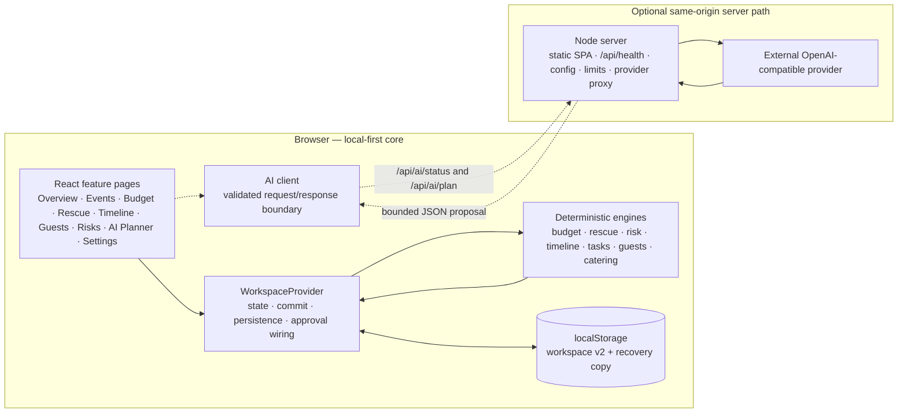

<div align="center">

# UTSAV AI

**Plan Smarter. Celebrate Better.**

An intelligent, local-first celebration planning workspace with deterministic budgets, explainable risk detection, and a constraint-aware Event Rescue flow.

Built for **PromptWars Virtual — Challenge 5** · Category: **Intelligent celebration planning and event management**

`React 19` · `TypeScript` · `Vite` · `Tailwind CSS` · `Node.js`

</div>

> **Project status:** local-first hackathon prototype, **prepared for deployment but not deployed**. Core planning works entirely in the browser. AI suggestions are optional, advisory, and require a running API server plus your own provider credentials. Deployment configuration for a single same-origin Node web service is included, but **no public URL, hosted demo, account system, or cloud sync exists**. See [docs/DEPLOYMENT.md](docs/DEPLOYMENT.md).

---

## Contents

- [Project overview](#project-overview)
- [Key features](#key-features)
- [Implementation status](#implementation-status)
- [What makes UTSAV AI different](#what-makes-utsav-ai-different)
- [Technology stack](#technology-stack)
- [Architecture](#architecture)
- [Getting started](#getting-started)
- [AI configuration](#ai-configuration)
- [Deployment](#deployment)
- [Example workflow](#example-workflow)
- [Testing and quality](#testing-and-quality)
- [Security and privacy](#security-and-privacy)
- [Limitations and future improvements](#limitations-and-future-improvements)
- [Documentation](#documentation)
- [License](#license)

---

## Project overview

UTSAV AI is a single-user celebration planning workspace for events such as weddings, birthdays, corporate gatherings, anniversaries, and festivals. It keeps the practical planning surface in one place:

- events and their planning context;
- per-event budgets, protections, and emergency reserves;
- preparation tasks and a chronological activity timeline;
- guest RSVPs and a deterministic catering estimate;
- explainable risk findings derived from saved planning data;
- **Event Rescue**, which turns a changed requirement into a validated, reviewable corrective proposal.

The central design decision is that **deterministic code owns every fact that matters**. Budget arithmetic, overrun detection, repair feasibility, timeline overlaps, guest counts, catering math, risk severity, and proposal validation are all implemented as pure TypeScript rules. AI is an optional planning assistant, not an authority: it cannot set totals, approve its own suggestions, change protected budgets, or mutate saved data without an explicit confirmation.

UTSAV AI is designed for the moment a plan stops fitting: the budget is reduced, the guest count grows, the date moves, or a venue assumption changes. Instead of only warning about the problem, Event Rescue shows the evidence, computes a constrained repair, compares the original and proposed plans, and waits for the user to approve or reject it.

## Key features

### Event workspace and planning context

Create and edit events with client-side validation, search and filter the event list, and keep tasks, guests, timeline activities, catering estimates, budgets, and risk findings isolated per event. Events carry a category, date, venue, expected guest count, total budget, planning status, optional setting and theme, accessibility answers, and outdoor-contingency confirmation.

On a first run, the app loads a clearly labelled sample workspace so every screen can be explored immediately. Sample events can be removed without touching user-created records, and restored later. Event deletion is not implemented.

### Budget Planner

Each event has one budget with a total, itemised categories, and an optional protected emergency reserve. A category is either **protected** or **flexible with a minimum planned amount**. The planner calculates planned expenditure, remaining or overrun amounts, utilisation, variance, reserve status, and overspending trends from integer minor units. A deterministic repair proposal can reduce only eligible flexible categories, never below their minimums, and never changes the total. The repair is advisory and applies only after explicit review and approval.

### Event Rescue

Event Rescue evaluates a proposed change against the saved event, budget, tasks, activities, guests, and catering assumption. It reports findings with evidence, recalculates the affected plan, produces a constrained corrective proposal when one is feasible, validates the result, and prevents approval when the proposal is stale, duplicated, infeasible, or violates a protected constraint. The saved event remains the original plan until the user accepts the proposal. Acceptance is atomic and revalidates everything against the current saved event.

### Timeline and tasks

Timeline activities use local date-time ranges, must end after they start, and are displayed chronologically. Overlapping activities are flagged as potential conflicts for review; the app never silently moves, merges, or deletes them. Preparation tasks support priorities, due dates, open/completed status, overdue detection, and completion progress. Creating, editing, completing, reopening, and deleting activities or tasks are supported, with confirmation for destructive actions.

### Guest management and catering estimate

Guest records track RSVP status (`pending`, `confirmed`, `declined`), dietary preference, accessibility request, and notes. Guest counts remain separate from expected attendance. The deterministic catering estimator uses confirmed RSVPs when guest records exist, otherwise the event's expected guest count, and labels the input as an estimate. The user supplies a per-person cost assumption and a whole-percentage buffer; the result is an assumption-based estimate, not a vendor quote.

### Risk Intelligence

Risk Intelligence is a deterministic, in-process detection engine. It turns saved planning data into findings across financial, scheduling, guest and catering, venue and contingency, and rescue-proposal consistency categories. Every finding carries a stable ID, severity, certainty, evidence, recommended action, related entities, status, source module, and rule ID. Repeated analyses reconcile without duplicating open findings; resolved issues stay in history; dismissal is recorded separately from resolution, and dismissed findings can be restored. Thresholds live in a validated central configuration. Risk Intelligence is not AI, does not use a predictive model, and never mutates saved records.

### Persistence, backup, and recovery

The workspace is stored in the browser's `localStorage` under `utsav-ai.workspace.v1` with schema version 2. Loading validates the payload and salvages valid records when part of it is malformed. When saved data is unreadable or only partially usable, a recovery copy of that original payload is written under `utsav-ai.workspace.recovery.v1` if no earlier copy exists. The app surfaces load, partial-load, save-failure, and storage-unavailable states.

Settings can export the entire workspace as a validated JSON file and import a file only after whole-file validation and explicit confirmation. Import replaces the workspace and is not a merge. There is no backend database, cloud sync, or automatic external backup.

### AI Planner

The AI Planner builds a privacy-minimal aggregate context for one selected event, calls the same-origin API server only when it is configured, parses provider output as `unknown`, validates it against shared Zod contracts, and runs deterministic checks before showing a proposal. A proposal can add only new open tasks and timeline activities, and only after the user previews the selected items and approves the change. Budgets, guests, events, protected priorities, and risk findings are never changed by AI output.

A deterministic local outline is always available and is visibly labelled **Not AI-generated**. When no provider is configured or the server is unavailable, the app remains fully usable through this fallback.

### Accessibility and keyboard use

The UI uses semantic landmarks, labelled controls, visible focus states, keyboard-operable dialogs and navigation, status announcements, and reduced-motion support. Automated tests cover several keyboard flows, including mobile navigation focus handling and dialog Escape behavior. This is not a certified accessibility audit or screen-reader certification.

## Implementation status

Statuses are based on source inspection and the test suite available in this repository. A feature is not marked verified merely because it appears in the UI.

| Area | Status | What is true today |
| --- | --- | --- |
| Event workspace | **Implemented and verified** | Create, edit, search, filter, sample-data controls, per-event isolation. No delete. |
| Budget Planner | **Implemented and verified** | Integer-minor-unit totals, categories, protections, minimums, reserve, overrun, deterministic repair with explicit approval. |
| Event Rescue | **Implemented and verified** | Deterministic findings, constrained proposal, validation, before/after review, stale and duplicate rejection, atomic approval. |
| Timeline and tasks | **Implemented and verified** | Activity validation, chronological list, overlap review, task priorities, overdue detection, completion progress, confirmed deletion. |
| Guests and RSVP | **Implemented and verified** | Create/edit/search/filter, separated RSVP counts, per-event isolation, confirmed deletion. |
| Catering estimator | **Implemented and verified** | Confirmed-RSVP or expected-count basis, whole-percent buffer rounded up, per-event assumption storage, budget comparison. |
| Risk Intelligence | **Implemented and verified** | Deterministic findings, filters, evidence, dismissal history, restore, reconciliation, proposal-consistency checks. |
| Local persistence | **Implemented and verified** | Schema-versioned load, valid-record salvage, recovery copy, save/load status surfaces. |
| Backup export and import | **Implemented and verified** | Validated whole-workspace JSON export; whole-file validation and explicit confirmation before import. |
| Sample workspace | **Implemented and verified** | Clearly labelled sample events with remove and restore controls; user records preserved. |
| AI deterministic outline | **Implemented and verified** | Always available, derived from saved data, labelled **Not AI-generated**, no invented prices or bookings. |
| AI provider suggestions | **Requires external configuration** | Implemented and covered by automated tests with a mocked provider. A real provider call requires a running API server, a real key, and a compatible model; no live-provider run is verified in this repository. |
| Production static serving | **Implemented and verified locally** | The Node server can serve the built SPA with `/api` on the same origin, SPA fallback, cache headers, and `/api/health`. Verified against a local production build; no platform deployment was performed. |
| Deployment configuration | **Prepared, not deployed** | `render.yaml`, `.node-version`, `npm start`, environment documentation, and [docs/DEPLOYMENT.md](docs/DEPLOYMENT.md) exist. No service has been created and no public URL was tested. |
| Responsive layout and keyboard access | **Implemented but not fully verified** | Responsive layouts and mobile navigation focus behavior are implemented; automated tests cover main navigation and dialogs. Physical devices, all viewport combinations, and screen readers are not exhaustively verified. |
| Event deletion | **Not implemented** | Events can be created and edited but not deleted. |
| Hosted database, accounts, cloud sync | **Not implemented** | The app is single-user and browser-local; there is no server database or sign-in. |
| Live vendor prices, bookings, availability, weather | **Not implemented** | No vendor, calendar, payment, or weather integration exists. |
| Payments | **Not implemented** | Nothing in this repository processes payments. |
| CI pipeline | **Not implemented** | Verification commands are run locally; no CI configuration is included. |

For per-feature evidence and scope notes, see [docs/FEATURE_STATUS.md](docs/FEATURE_STATUS.md).

## What makes UTSAV AI different

Many planners can display a budget or a checklist. UTSAV AI focuses on the harder moment when the plan no longer fits, using a repeatable loop:

1. **Detect the problem** from saved planning data.
2. **Explain the evidence** so the user can see why it was flagged.
3. **Generate a corrective proposal** using deterministic, constrained rules.
4. **Validate the proposal** against protected categories, minimums, totals, dates, guest counts, and saved-record consistency.
5. **Show the original and proposed plans side by side**, including remaining unresolved issues.
6. **Require explicit approval.** Nothing changes before acceptance, and stale or duplicate proposals are rejected.

The intended trust boundary is straightforward: **AI can suggest additions; deterministic code decides what is financially and structurally valid.** Event Rescue never pretends to contact a vendor, check live availability, confirm the weather, or verify a venue's accessibility. It is a planning-data repair tool, not an autonomous event operator.

The differentiator is implemented for the app's saved-data domain. It is not a general-purpose solver, does not claim optimal repairs (the budget repair is deterministic and greedy), and does not cover external facts the app cannot observe.

## Technology stack

Versions are declared in [package.json](package.json); the committed `package-lock.json` pins the install.

| Layer | Technology |
| --- | --- |
| UI runtime | React 19.3, React DOM 19.3 |
| Language | TypeScript ~6.0 in strict mode (`noUncheckedIndexedAccess`, `exactOptionalPropertyTypes`, `verbatimModuleSyntax`) |
| Build tool | Vite 8.3 with `@vitejs/plugin-react` |
| Styling | Tailwind CSS 4.3 via `@tailwindcss/vite`, design tokens and component classes in `src/app/index.css` |
| Routing | React Router DOM 7.18 |
| Icons | Lucide React |
| Validation | Zod 4.6 for shared AI contracts and boundary data |
| State | React context and `useReducer`; no state-management library |
| Persistence | Browser `localStorage`; schema-versioned JSON. No database. |
| Optional API and production server | Node.js 24 native TypeScript execution and the built-in `node:http` server; no framework. In production it also serves the built SPA. |
| AI provider interface | OpenAI-compatible Chat Completions endpoint, server-side only |
| Tests | Vitest 5, jsdom 30, Testing Library, `@testing-library/user-event` |
| Quality | ESLint 10 with `typescript-eslint`, `tsc -b` |

No database, Docker, PostgreSQL, Redis, or external service is required for the core application, the production server, or the automated tests. Node.js `>=24.15.0` is required for the server and supports running the TypeScript entry point directly. This documentation was verified on Node.js **v24.16.0** and npm **11.13.0**.

## Architecture

The application is feature-first. Feature folders own their UI, domain rules, and state integrations; shared presentation components stay small; deterministic calculations stay out of JSX.



In development, Vite proxies `/api` to the local Node server. In the prepared production topology, one Node service serves both the built SPA and `/api` from the same origin, so the browser continues to use relative `/api` URLs and no CORS configuration is required. See [docs/DEPLOYMENT.md](docs/DEPLOYMENT.md).

A deterministic risk analysis runs at workspace boundaries, so saved mutations refresh findings consistently without a background service. Event Rescue and AI approvals both persist before state is replaced in the browser, and both revalidate against the current saved event before applying anything.

Core source layout:

```text
src/
  app/          Application entry, routes, global styles
  components/   Small reusable presentation components and navigation
  features/     Feature-owned UI, state, and domain rules
    ai/         AI contracts, privacy-minimal context, client, validation, approval, fallback
    budget/     Budget contracts, calculations, validation, repair, planner UI
    catering/   Deterministic catering estimator
    dashboard/  Overview selectors and dashboard UI
    events/     Event forms, filters, mutations, event UI
    guests/     Guest rules and UI
    rescue/     Rescue findings, proposal engine, validation, approval, UI
    risks/      Risk thresholds, engine, reconciliation, selectors, UI
    settings/   Workspace status, sample controls, backup and restore
    tasks/      Task rules, sorting, filtering, progress
    timeline/   Activity rules, overlap detection, timeline UI
    workspace/  Workspace provider, reducer, storage, sample data
  lib/          Framework-free date and money helpers
  services/     Reserved for future in-browser I/O boundaries
  test/         Shared test setup and fixtures
  types/        Shared domain and UI contracts
server/         Node server: config, HTTP hardening, provider proxy, static SPA serving, health
```

For module responsibilities, data relationships, persistence flow, approval sequencing, and the AI request boundary, see [docs/ARCHITECTURE.md](docs/ARCHITECTURE.md).

## Getting started

### Prerequisites

- **Node.js `>= 24.15.0`** (verified with v24.16.0)
- **npm** (verified with 11.13.0)
- A current browser with JavaScript and `localStorage` enabled
- No database, Docker, external account, or API key is required for the core planner
- Optional AI: a server-side provider API key and a model that supports OpenAI-compatible Chat Completions with JSON object output

### Install and run

From the project folder:

```bash
npm install
npm run dev
```

Vite prints the local URL in the terminal, typically `http://localhost:5173`. If that port is occupied, Vite selects another port and prints it.

The first run seeds a labelled sample workspace. Use **Settings → Sample data** to add samples later or remove them; removing sample data keeps events you created.

### Verification commands

| Command | Purpose |
| --- | --- |
| `npm run typecheck` | Type-check the client and Node configurations with `tsc -b` |
| `npm run lint` | Run ESLint with `--max-warnings=0` |
| `npm run test` | Run the Vitest suite once |
| `npm run test:watch` | Run Vitest in watch mode |
| `npm run build` | Type-check and create the production bundle in `dist/` |
| `npm run preview` | Serve the built bundle with Vite's preview server (no API) |
| `npm start` | Run the Node server; with `SERVE_STATIC=true` it also serves `dist/` and `/api` on one origin |

### Optional AI API server

Run the frontend and the API server in two terminals:

```bash
npm run dev
```

```bash
npm run dev:api
```

The API server listens on `127.0.0.1:8787` by default. It loads `.env.local`, then `.env` if present; because Node's repeated `--env-file-if-exists` flags let the later file win, keep real values in `.env.local` and avoid conflicting duplicates in `.env`. Vite proxies `/api` requests from the frontend to that local server. For first-time setup, copy `.env.example` to `.env.local`, add a provider key and model, and leave the file untracked. Do not add a `VITE_` prefix to any server credential.

Without provider configuration the AI Planner reports that AI is not configured, disables provider generation, and keeps the deterministic outline available. To preview the production server locally after a build:

```bash
npm run build
SERVE_STATIC=true AI_SERVER_HOST=127.0.0.1 AI_SERVER_PORT=8790 npm start
```

Then open `http://127.0.0.1:8790`. Detailed prerequisites, environment notes, and troubleshooting are in [docs/SETUP.md](docs/SETUP.md).

## AI configuration

All AI credentials and provider settings are read by the **Node server only**. They are never compiled into the browser bundle, and no `VITE_*` variable is used for secrets.

| Variable | Required for AI | Purpose |
| --- | --- | --- |
| `AI_PROVIDER_API_KEY` | Yes | Provider credential, read from the server environment. Never expose it as a `VITE_*` value. |
| `AI_MODEL` | Yes | Provider model identifier. There is no assumed default model. |
| `AI_BASE_URL` | Optional | OpenAI-compatible Chat Completions base URL. The template shows a public example endpoint; availability and model names depend on your provider. |
| `AI_PROVIDER_NAME` | Optional | Safe display label surfaced by the status endpoint. |
| `AI_REQUEST_TIMEOUT_MS`, `AI_MAX_OUTPUT_TOKENS`, `AI_RATE_LIMIT_MAX`, `AI_RATE_LIMIT_WINDOW_MS`, `AI_MAX_REQUEST_BYTES` | Optional | Server-side limits with validated ranges; defaults are documented in `.env.example`. |
| `AI_SERVER_HOST`, `AI_SERVER_PORT`, `PORT`, `SERVE_STATIC`, `STATIC_DIR` | Optional | Server binding, hosting-platform port, and production static-serving settings. They contain no secrets. |

The server must be able to call an OpenAI-compatible Chat Completions endpoint that supports JSON object responses. A provider key alone is not enough; the model must be valid for the configured provider.

**Behavior without credentials or server**

- The app loads and all deterministic features work normally.
- The AI status area reports **Not configured** or **Unavailable** without inventing a provider state.
- Provider generation is disabled; the deterministic outline remains available and is labelled **Not AI-generated**.
- No paid request is made by the test suite. Tests use mocked providers.

**Behavior with a configured provider**

- A request is shaped from aggregate event data only. Guest names, notes, dietary or accessibility text, other events, local-storage contents, and exported data are excluded.
- The browser validates the request; the server applies a request-body limit, timeout, output-token cap, and per-client fixed-window rate limit; one bounded provider attempt is made with no automatic retry loop.
- Provider output is parsed as `unknown`, validated with shared Zod schemas, and checked for invalid dates, reversed activity ranges, invalid integer money, unsafe sums, and unknown entity references.
- A validated proposal is advisory until the user selects items, previews them, and confirms. Only new open tasks and new timeline activities can be added. Stale, duplicate, invalid, blocking, or unselected proposals cannot be applied.

No real credential, provider body, prompt, or guest data is logged or displayed by this repository's server code. Never commit `.env`, `.env.local`, provider keys, or screenshots containing secrets. No live provider call was verified during the documentation pass; the provider behavior described here is from source inspection and mocked automated tests.

## Deployment

**Status: prepared for deployment, not deployed.** No hosted service was created, no public URL was tested, and no DNS or platform configuration was applied.

The included configuration targets a **single same-origin Node web service** (a Render Blueprint is provided in [render.yaml](render.yaml)). The service builds the Vite app, then serves `dist/` and `/api` from one process. This matches the application's actual shape:

- The core planner is a static SPA with browser `localStorage`; it needs no server or database.
- The only backend is an optional stateless AI proxy that already expects same-origin `/api` calls.
- A single service avoids CORS, a second deployment, a serverless adapter, and an unnecessary database.

Key files and settings:

| Item | Value |
| --- | --- |
| Build command | `npm ci --include=dev && npm run build` (dev dependencies are required by the build) |
| Start command | `npm start` (`node server/index.ts`) |
| Health check | `GET /api/health` → `200 {"status":"ok"}` |
| Production static serving | `SERVE_STATIC=true`; `STATIC_DIR=dist` by default |
| Platform port | The platform's `PORT` is used when `AI_SERVER_PORT` is unset |
| Host binding | `AI_SERVER_HOST=0.0.0.0` on the platform; loopback locally |
| Node version | `.node-version` (`24.16.0`) |
| Database | None |

Set AI provider variables only in the hosting platform's secret environment settings, never in committed files. Without them, the app remains fully usable: the AI status reports **Not configured** and the deterministic outline stays available.

Detailed instructions, smoke tests, troubleshooting, and limitations are in **[docs/DEPLOYMENT.md](docs/DEPLOYMENT.md)**. The repository does not claim that any step in that guide has already been performed on a hosting platform.

## Example workflow

The following walkthrough uses the bundled sample workspace and the exact scenario used for verification. Values are fixed in the sample data; relative dates shift with the current date.

1. **Open the workspace.** On a fresh browser profile, the sample events appear with a sample-data label. Choose **Ananya & Rohan's Wedding** from the Overview or My Events.
2. **Inspect the budget.** In **Budget Planner**, the event has a total of `₹45,00,000`, a planned expenditure equal to the total, protected Venue/Catering/Photography categories, flexible Décor/Entertainment/Transport categories with minimum floors, and a protected emergency reserve.
3. **Describe a change in Event Rescue.** Select the same event, leave the date and guest count unchanged (`240`), and set the total budget to `₹42,00,000`. Submit **Analyze rescue options**.
4. **Review the evidence.** The analysis identifies an overallocation of `₹3,00,000` and related missing-catering-estimate, accessibility, and outdoor-contingency observations. The proposal reduces Décor from `₹8,00,000` to `₹6,00,000` and Entertainment from `₹4,50,000` to `₹3,50,000`, leaves Transport unchanged, and preserves all protected categories and minimums. The proposal panel reports deterministic validation success and the remaining issues.
5. **Confirm that nothing has been applied.** The saved event still shows the original budget and values until **Accept proposal** is confirmed.
6. **Approve the proposal.** Acceptance revalidates the proposal against the saved event, persists the change atomically, updates the event, and announces the new planned expenditure with the remaining risks. Reload the page to confirm the approved values persist.
7. **Optional AI check.** With the API server configured, open **AI Planner**, select the event, choose a request type, generate a proposal, and inspect the preview before approving selected tasks or activities. Without configuration, use **Build deterministic outline** and confirm it is labelled **Not AI-generated**.

A shorter backup path for a live demo is included in [docs/DEMO_SCRIPT.md](docs/DEMO_SCRIPT.md); it avoids depending on external AI availability.

## Testing and quality

The required verification suite was last run on **2026-10-25** with Node.js **v24.16.0** and npm **11.13.0**. These are actual results from this repository, not target numbers.

| Check | Command | Result |
| --- | --- | --- |
| Type check | `npm run typecheck` | **Passed** (`tsc -b`, exit 0) |
| Lint | `npm run lint` | **Passed**, zero warnings (`--max-warnings=0`) |
| Automated tests | `npm run test` | **496 tests passed across 47 test files** |
| Production build | `npm run build` | **Passed**; single JS and CSS bundles emitted |
| Dependency audit | `npm audit` | **0 vulnerabilities** reported |

The build emits a Vite warning that the single JavaScript chunk exceeds 500 kB after minification (approximately 835.81 kB JS, 223.61 kB gzip; 53.72 kB CSS, 9.40 kB gzip). This is a bundle-size warning, not a build failure. Code splitting has not been implemented.

What the automated suite covers includes budget arithmetic and protected constraints, deterministic repair, rescue proposal validation and stale/duplicate approval rejection, risk reconciliation and dismissal history, workspace persistence including salvage and migration, event editing and cross-event isolation, timeline overlap detection, task rules, guest and catering rules, AI contract validation, privacy isolation, mocked provider failures and limits, and the main UI flows with Testing Library.

Limitations of the current verification:

- The AI provider path is tested with a mocked provider or local test server path; no real paid provider call was made and no live-model output is claimed as verified.
- There is no committed end-to-end browser automation suite (for example Playwright or Cypress). Browser checks during development were manual/headless QA, not a reproducible checked-in suite.
- No CI workflow runs these commands; they are local commands.
- Screen-reader behavior and physical-device responsiveness are not certified.
- Tests do not prove that external facts such as vendor availability, prices, or weather are correct; the app has no such integrations.

## Security and privacy

### Data locality

- Core planning data stays in the browser under `localStorage`. There is no database, account, analytics pipeline, or cloud sync. The prepared production server is stateless: it serves files and proxies optional AI requests; it does not store planning data.
- `localStorage` is per browser and per origin. Deploying under a different URL or using another browser or device starts with an empty workspace. If `localStorage` is treated as a database, it should be described as browser-local demo storage, not durable multi-device storage.
- Export files are plaintext JSON downloads. Treat them as sensitive planning documents, especially if they contain guest notes or accessibility information.
- Anyone with access to the same browser profile and machine can read the local workspace. The app does not encrypt browser storage or implement authentication.
- Clearing site data can remove the workspace; use **Settings → Export** for backups. There is no automatic external backup, and there is no cross-device sync.

### AI privacy boundary

- The AI request contains aggregates for one selected event: budget values, counts, dates, categories, task/activity summaries, and risk summaries. Guest names, guest notes, dietary and accessibility text, other events, local-storage contents, and exported data are excluded by the context builder.
- Requests are length- and size-capped in the browser and at the server. Lists are bounded.
- Guest data is not sent to an AI provider by the application code; guest records remain local.

### Server-side credential handling

- Provider credentials are read from server environment variables only. They are not read from `VITE_*` values, source, or committed configuration.
- The server is a stateless provider proxy. It does not log prompts, provider response bodies, keys, guest data, or stack traces to its request log. It does log safe request metadata: route, method, status, duration, and request ID.
- The server uses one bounded provider attempt with a timeout and output-token cap, a request-body limit, a per-client in-memory fixed-window rate limit, JSON-only API endpoints, `Cache-Control: no-store` on API responses, `X-Content-Type-Options: nosniff`, and `Referrer-Policy: no-referrer`. It does not grant CORS access. It binds to loopback by default and must be configured to `0.0.0.0` on a hosting platform.
- The rate limiter is in-memory and resets when the server restarts. It is not shared across instances, so the prepared deployment assumes one instance.
- The prepared deployment has no application authentication, so anyone with the URL can use the workspace in their own browser and can trigger configured AI requests. A public AI-enabled deployment should add access control or a spending limit before sharing the URL widely. Without provider credentials, no AI request can be made.

### Validation and approval

- Shared Zod contracts are used across browser and server boundaries so validation cannot drift silently.
- Untrusted data is parsed as `unknown` and validated at forms, imports, local storage, API responses, and provider output.
- Event Rescue and AI approvals revalidate the request, proposal, and saved record; reject stale, duplicate, infeasible, or invalid proposals; persist before replacing in-memory state; and leave records unchanged on failure.
- AI cannot modify budgets, guest records, events, protected priorities, risk findings, or its own approval state.

### Known security limitations

- **No Content-Security-Policy (CSP) is configured** in the repository or the server's static/API headers. The app does not claim one.
- There is no authentication, authorization, multi-user isolation, or encrypted storage because this is a single-user prototype.
- The API server has no TLS termination of its own. The prepared platform deployment relies on the hosting provider for HTTPS; that was not verified because no deployment occurred. Do not expose the raw Node process publicly without TLS.
- Automated tests cover many validation and approval paths but are not a comprehensive security audit or a production penetration test.
- No hosted environment exists in which to verify deployment headers, network controls, or operational monitoring. Production behavior on a hosting platform is unverified.

## Limitations and future improvements

### Current limitations

- The workspace is limited to one browser profile and one origin; there is no cross-device sync, account, or shared collaboration. A hosted deployment does not change this.
- Events cannot be deleted, and imports replace rather than merge the workspace.
- If browser storage is cleared and no export exists, the workspace cannot be recovered by the app or by the server.
- There is no integration with real vendors, calendars, weather, payments, invitations, or booking systems, so live prices, availability, and confirmations are never verified.
- Risk findings and rescue proposals depend on the accuracy of saved planning assumptions. They are not financial, legal, or vendor advice.
- The deterministic budget repair is greedy and deterministic, not mathematically optimal.
- AI suggestions require external configuration and provider compatibility; the repo's tests use mocked providers, so real-model quality and latency are not evaluated here.
- The production build is a single large JavaScript chunk; code splitting and bundle optimisation are future work.
- Mobile navigation and dialogs have automated keyboard tests, but the interface has not been tested on a broad matrix of physical devices or screen readers.
- The repository includes no CI workflow, no committed E2E suite, and no screenshots or demo video.
- Deployment is prepared but not performed. The Render Blueprint and production server were verified only locally, not on the platform.
- The project has no chosen license yet (see below).

### Planned improvements

These are **not implemented** and should not be read as commitments or current behavior:

- Event deletion with confirmation and a recoverable path.
- Optional hosted backend, accounts, and explicit multi-device sync with a clear migration story.
- More Event Rescue scenarios, including configurable repair strategies and scenario comparison.
- Calendar export, invitation workflows, and integration adapters for real vendor availability where an authoritative source exists.
- Further accessibility validation with screen readers and physical devices.
- Bundle code splitting, a committed E2E suite, and CI checks.
- A platform deployment with verified HTTPS, headers, and post-deploy smoke tests, if the owner authorizes it.
- A governance and licensing decision suitable for public reuse.

## Documentation

- [docs/SETUP.md](docs/SETUP.md) — supported environment, installation, environment variables, running the frontend and optional API, persistence notes, troubleshooting, and commands.
- [docs/ARCHITECTURE.md](docs/ARCHITECTURE.md) — module responsibilities, data model, persistence flow, budget and risk engines, Event Rescue approval, AI validation, error handling, and security boundaries.
- [docs/DEMO_SCRIPT.md](docs/DEMO_SCRIPT.md) — a realistic three-to-four-minute competition demo script with exact sample values, expected results, a backup path, privacy warnings, and a recording checklist.
- [docs/FEATURE_STATUS.md](docs/FEATURE_STATUS.md) — detailed per-feature status, evidence, scope, and known gaps.
- [docs/DEPLOYMENT.md](docs/DEPLOYMENT.md) — prepared single-service hosting architecture, environment variables, local production verification, smoke tests, troubleshooting, and deployment limitations. No deployment has been performed.

For the engineering conventions used in this repository, see [AGENTS.md](AGENTS.md).

## License

**No license is specified for this project yet.** There is no `LICENSE` file in the repository, and `package.json` is marked `"private": true`. Absence of a license means others do not receive explicit permission to copy, modify, or redistribute the code. Before publishing the project as an open-source repository, the owner must choose a license and add the corresponding `LICENSE` file. No license is implied by this README.

Third-party dependencies remain under their own licenses.
