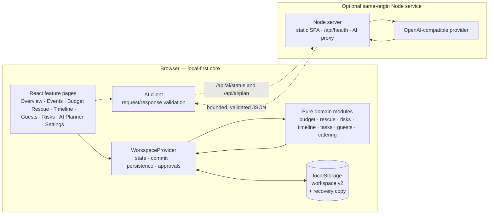
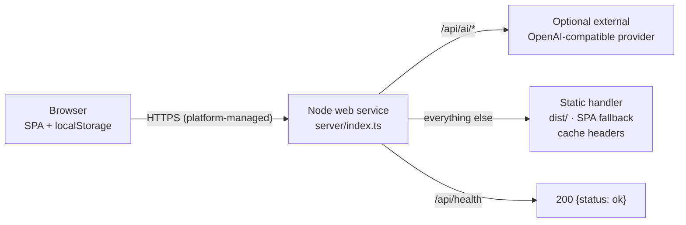
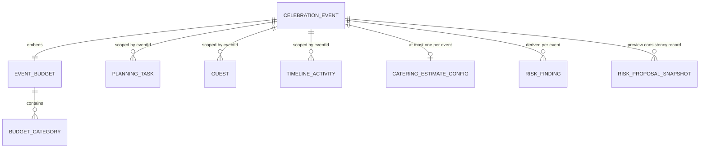
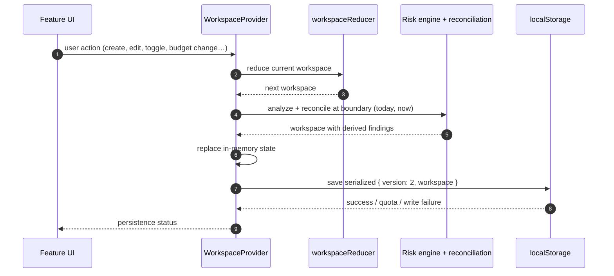
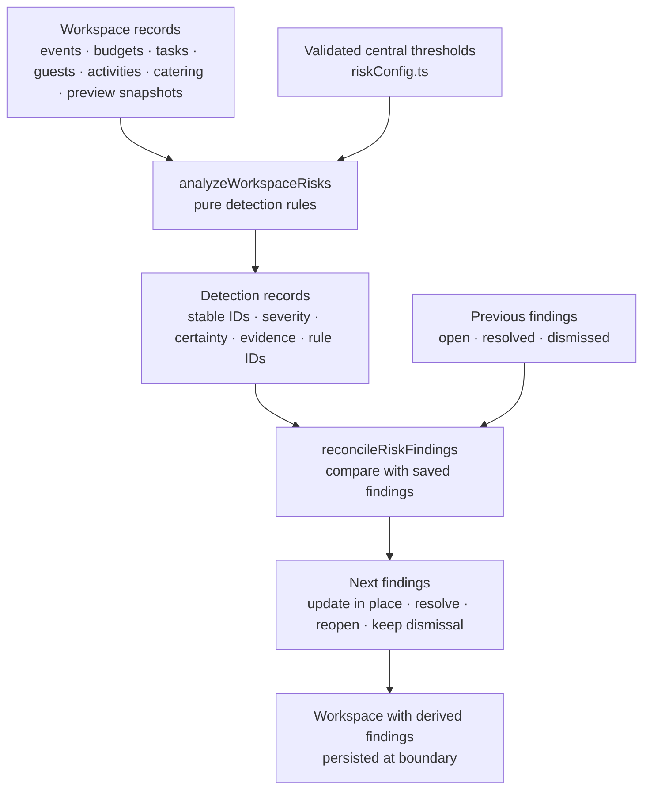
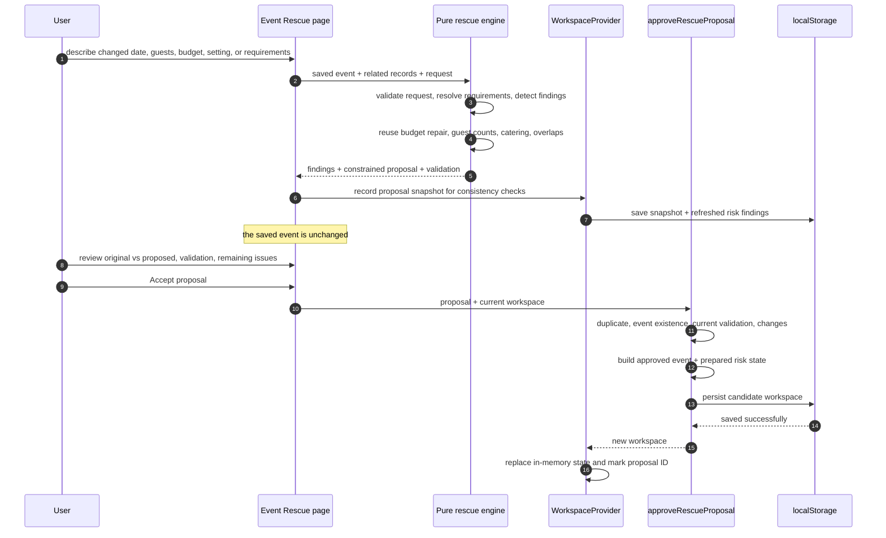

# UTSAV AI — Architecture

This document describes the architecture that exists in the repository. It is a map of responsibilities and trust boundaries, not a roadmap. Planned work is called out as planned.

## Architectural stance

UTSAV AI is a **local-first, single-user React application** with an **optional, stateless Node.js provider proxy** that can also serve the production build. Three principles shape the design:

1. **Deterministic code owns planning facts.** Budget arithmetic, repair feasibility, overrun detection, guest counting, catering math, timeline overlap detection, risk severity, and proposal validity are pure TypeScript functions. AI never supplies arithmetic, totals, feasibility, or approval.
2. **Saved state changes only through validated, explicit actions.** Event Rescue and AI proposals are review-first. Approval revalidates the current saved record, persists before the UI adopts the new state, and rejects stale, duplicate, invalid, or infeasible proposals.
3. **Every external boundary is treated as untrusted.** Forms, local storage, imports, HTTP requests, HTTP responses, and provider output are parsed as unknown and validated before use. URL query parameters are treated as selections and resolved only against existing workspace records.

There is no account system, server-side data store, database, job queue, background worker, or multi-user synchronization. The prepared production topology is one stateless Node service that serves the static SPA and `/api` from the same origin; no deployment has been performed.

## System context



Core planning does not require the right-hand side of the diagram. When the Node server or provider is unavailable, the browser application remains operational and the deterministic outline remains available. In development, Vite serves the SPA and proxies `/api`; in the prepared production mode, the Node server serves both from one origin. There is no CORS grant because cross-origin access is not part of the architecture.

## Production topology (prepared, not deployed)



The production entry point uses the same Node process for three responsibilities:

1. **API**: `/api/ai/status`, `/api/ai/plan`, and safe JSON errors for `/api/*`.
2. **Health**: `/api/health` returns `200 {"status":"ok"}` without checking or revealing AI configuration. It is suitable for a platform health check.
3. **Static SPA**: when `SERVE_STATIC=true`, `server/static.ts` serves `dist/`. Unknown extensionless routes fall back to `index.html` so client-side routes survive refresh; missing asset files return 404. Hashed `/assets/*` responses are immutable-cached, HTML is `no-cache`, and dot-segments, dotfiles, and path escapes are rejected.

`server/app.ts` routes `/api` and `/api/*` to the API handler and everything else to the static handler, so an unknown API route remains a JSON 404 rather than becoming an HTML page. `server/index.ts` validates the static root at startup and refuses to start with static serving enabled when `dist/index.html` is missing.

| Setting | Effect |
| --- | --- |
| `AI_SERVER_HOST` | Bind address; loopback locally, `0.0.0.0` behind a platform router |
| `AI_SERVER_PORT` | Explicit port; takes precedence over `PORT` |
| `PORT` | Hosting-platform port, used only when `AI_SERVER_PORT` is unset |
| `SERVE_STATIC` | Exactly `true` or `false`; enables static SPA serving |
| `STATIC_DIR` | Static directory, default `dist` |

The prepared Render Blueprint (`render.yaml`) uses one web service with `npm ci --include=dev && npm run build`, `npm start`, and health check `/api/health`. The explicit `--include=dev` is required because the production environment makes npm omit build-time dev dependencies by default. The service is stateless, so the in-memory rate limiter is not shared across instances and the prepared configuration assumes one instance. See [DEPLOYMENT.md](DEPLOYMENT.md) for the full platform procedure and smoke tests. This topology has been exercised only locally; no platform deployment exists.

## Module responsibilities

| Location | Owns | Must not own |
| --- | --- | --- |
| `src/app/` | Application entry, React Router routes, global Tailwind styles | Feature business rules |
| `src/components/` | Small reusable presentation components, app shell, navigation | Domain calculations or persistence |
| `src/features/workspace/` | Workspace context, reducer, guarded local storage, sample data, mutation wiring, approvals at the boundary | Feature-specific rules already owned elsewhere |
| `src/features/events/` | Event forms, validation, filters, pure create/update mutations, event UI | Budget arithmetic |
| `src/features/budget/` | Budget contracts, calculations, validation, mutations, form parsing, deterministic repair, planner UI | AI arithmetic, persistence |
| `src/features/rescue/` | Rescue contracts, findings, request resolution, proposal generation, validation, approval, UI | Duplicated budget, guest, catering, or timeline rules |
| `src/features/risks/` | Risk contracts, central thresholds, detection engine, reconciliation, dismissal/restore, proposal snapshots, selectors, UI, presentation metadata | Mutating planning data or approving anything |
| `src/features/timeline/` | Activity contracts, validation, chronological sorting, status filters, overlap detection, timeline UI | Automatically resolving conflicts |
| `src/features/tasks/` | Task validation, normalization, sorting, filtering, overdue detection, completion progress, suggested preparation tasks | Persisting suggestions as completed work |
| `src/features/guests/` | Guest validation, search, RSVP filters, counts, guest and catering-estimate UI | Sending guest data externally |
| `src/features/catering/` | Deterministic estimator using confirmed RSVPs or expected count, buffer math, per-event assumption | Treating estimates as vendor quotes |
| `src/features/ai/` | Shared AI contracts, privacy-minimal context builder, HTTP client, fallback outline, deterministic plan validation, preview/approval state, AI UI | Budget/timeline/guest/risk rules of its own; changing protected constraints |
| `server/` | Server-only environment config, HTTP routing and hardening, health endpoint, static SPA serving, rate limiting, provider adapter, prompt construction, response validation | Business logic, planning-data persistence, state between requests |
| `src/lib/` | Framework-free date and money utilities | React or feature state |
| `src/types/` | Shared domain and UI contracts | Runtime validation by itself |
| `src/test/` | Vitest setup and shared fixtures | Production behavior |

The optional server imports shared AI schemas from `src/features/ai/contracts.ts` with explicit `.ts` extensions so browser and server validation cannot drift. Server code runs directly under Node's native TypeScript execution, so it avoids non-erasable TypeScript syntax and uses explicit `.ts` imports.

## Data model

The canonical domain contracts live in `src/types/`. Money is always an integer amount in minor units (for example, paise) plus a currency code; it is never a floating-point major unit.



The relationships in the diagram are logical. The stored `Workspace` is a set of arrays:

- `events`: celebration events. Each event embeds exactly one `EventBudget`, which contains budget categories plus emergency-reserve configuration.
- `tasks`: preparation tasks with `eventId`, due date, priority, and `'open' | 'completed'` status.
- `guests`: guest records with `eventId` and RSVP status `'pending' | 'confirmed' | 'declined'`.
- `activities`: timeline activities with `eventId`, local `YYYY-MM-DDTHH:mm` start/end values, priority, and status.
- `cateringEstimates`: zero or one per event, with a per-person `Money` assumption, a whole-percent buffer, and an update timestamp.
- `riskFindings`: optional derived findings written back into the workspace so status, dismissal, and history survive across sessions.
- `rescueProposalSnapshots`: optional compact records used to detect proposals evaluated against outdated events. A snapshot is **not** a second approvable copy of the event.

Key model constraints:

- IDs are strings; events, tasks, guests, and activities carry `eventId` except for the embedded budget, which carries both `eventId` and budget `id`.
- Budget flexibility is a discriminated union: `{ mode: 'protected' }` or `{ mode: 'flexible', minimumPlanned }`. There is no parallel boolean.
- The emergency reserve is a protected budget category with the fixed ID `emergency-reserve`. It is part of planned expenditure, not extra money.
- Event dates are date-only `YYYY-MM-DD` strings; activity times are local date-time strings without a timezone offset. Date parsing helpers avoid timezone drift.
- Tasks and guests created in earlier persisted versions may lack timestamps or carry legacy fields; validated loading migrates or tolerates those shapes. New guest forms do not collect email.
- Risk findings carry a stable detection ID, an event scope, category, severity, certainty, evidence, recommended action, related entity references, detection timestamps, status, source module, rule ID, and a content fingerprint.
- AI proposals and rescue proposals generated in the UI are transient page state, not stored in the workspace. Only consent-gated applied changes become saved records, plus rescue preview snapshots for consistency checks.

## State and mutation flow

`WorkspaceProvider` owns the in-memory workspace and exposes actions through React context. There is no external state library.



Details that matter:

- The provider keeps a mutable ref to the latest workspace so sequential actions in the same tick build on the newest state, while React state still flows through the reducer.
- If a reducer action produces no state change, no persistence or risk pass occurs.
- Risk analysis exceptions are caught at the workspace boundary. The reduced workspace is retained, the error is surfaced, and risk findings may be out of date.
- **Approval flows are intentionally different from ordinary commits.** Event Rescue and AI approvals call the persistence boundary inside the approval function and only replace in-memory state after persistence succeeds. A failed save leaves the current state intact and reports a persistence failure.
- Import follows the same safety idea: validate the whole file, analyze the candidate, save it, and only then replace state. Import is a replace, not a merge.
- Approved rescue-proposal IDs and AI-plan IDs are tracked in memory for duplicate rejection during the session. The proposals themselves are not persisted as approvable objects.
- Risk dismissal and restoration are status changes on existing findings. They are persisted, but they do not alter the underlying planning records and are not a claim that an issue was fixed.

## Persistence flow

### Load

1. Read `utsav-ai.workspace.v1` from `localStorage` if browser storage is available.
2. If nothing is stored, seed the clearly labelled sample workspace.
3. If a payload exists, decode and validate it against the stored schema version.
4. Migrate supported legacy task and guest shapes to the current shapes.
5. Salvage valid records when parts of the payload are malformed. Record issues for the UI.
6. On an invalid or partial payload, attempt to write the original raw payload to `utsav-ai.workspace.recovery.v1` if no earlier recovery copy exists.
7. Run the deterministic risk analysis and reconciliation pass.
8. Expose a persistence status: local, partial load, load failed, save failed, or unavailable.

If storage is unavailable, the app still runs with sample data and in-memory changes; persistence status tells the user that changes will not survive the tab. A readable-but-invalid payload falls back to sample data without overwriting the existing saved payload immediately.

### Save

Each ordinary commit serializes `{ version: 2, workspace }` and writes it to `utsav-ai.workspace.v1`. Save failures are classified as quota, write failure, or unavailable. The UI keeps unsaved edits in the current tab and warns that they may not persist; the app does not silently pretend the save succeeded.

### Export and import

- Export first revalidates the whole in-memory workspace, then downloads JSON containing `version`, `exportedAt`, and `workspace`.
- Import rejects payloads longer than 5,000,000 characters, validates the entire decoded file, analyzes risk state, saves, and then replaces state. The Settings UI requires an explicit confirmation before replacing the current workspace.
- No export or import is sent to a remote service.

The app has no database schema, server migration path, or cloud conflict resolution because there is no server-side data store.

## Budget calculation boundary

All budget arithmetic is pure and framework-free in `src/features/budget/`:

- `calculations.ts` computes total planned, actual expenses, remaining/overrun, utilization, variance, category variance, reserve status, and aggregate totals.
- `validation.ts` validates money and category constraints at forms and boundaries.
- `mutations.ts` builds updated budgets without mutating the existing event.
- `repair.ts` proposes deterministic reductions when planned expenditure exceeds the total.

Repair rules:

- Only flexible categories can be reduced.
- A flexible category may not fall below its declared minimum planned amount.
- Protected categories never change.
- The total budget never changes as part of repair.
- Amounts stay valid safe integers in minor units.
- The algorithm is deterministic and greedy: candidates are ranked and reduced until the gap is covered or no reducible amount remains. It is not a claim of mathematical optimality.
- A repair proposal is advisory until explicitly approved. A shortfall is reported rather than hidden by inventing money or relaxing constraints.

The UI formats money but does not implement arithmetic. Event Rescue and the AI Planner call these shared modules instead of reimplementing budget rules.

## Risk analysis flow

Risk Intelligence is deterministic and in-process. It is not a predictive model and not an AI feature.



Important behavior:

- Detection IDs are stable for the event and rule scope, with optional entity keys. Re-running analysis updates an open finding in place instead of creating duplicates.
- An open issue that disappears becomes resolved and stays in history. A resolved issue that reappears is reopened.
- A dismissed finding remains dismissed while its content fingerprint is unchanged. A material severity or evidence change can reopen it. Dismissal is explicitly **not** resolution.
- Findings never cross event boundaries. Viewing or filtering the page does not resolve anything.
- Risk findings are derived, but their lifecycle and dismissal history are stored in the workspace so they survive reloads.
- Rescue proposal snapshots let the risk engine detect a proposal that was evaluated against an outdated event. Proposal-consistency findings are advisory; they never approve, apply, or mutate the proposal.
- Risk analysis runs at bootstrap, after ordinary workspace commits, after proposal-snapshot changes, on manual refresh, and as part of approval preparation. A long-lived tab can show day-sensitive findings as stale until the next boundary or refresh.

## Event Rescue flow

Event Rescue treats the saved event as the original plan. It separates **analysis** from **application**:



What the engine may and may not do:

- It may produce changed requirements (date, guest count, total budget, setting, theme, accessibility answers, contingency confirmation) and deterministic budget/category changes.
- It may recommend reductions only within the same protected/flexible/minimum rules as the budget engine.
- It never silently raises the total budget, changes guest counts, demotes saved protections, edits guests or schedules directly, or applies itself.
- It reuses budget calculations, timeline overlap detection, guest counts, and the catering estimator rather than duplicating them.
- Catering changes are proportional assumptions derived from the saved plan, not vendor quotes.
- Findings describe what can and cannot be repaired. Infeasible or partially repairable requests yield no approvable proposal or an honest remaining-issue list.
- Approval revalidates against the current event and day, rejects stale signatures and already-approved IDs, verifies at least one real change exists, persists atomically, and updates timestamps only on success.
- Successful approval can leave unresolved issues. The UI reports them; a rescue does not claim to fix external or unmodeled problems.

There is no hidden undo after approval. Any later correction is a normal user edit or a new analysis. Before approval, the proposal panel lists the planned changes so the user can review them.

## AI Planner architecture

AI is split across three boundaries: browser context, server, and external provider.

### Browser boundary

- `aiContext.ts` builds a privacy-minimal, stable aggregate context for **one** selected event. It excludes guest names, notes, dietary/accessibility text, other events, local-storage contents, and exports.
- `aiClient.ts` validates the outgoing request, calls `GET /api/ai/status` and `POST /api/ai/plan`, applies a client timeout, parses the response as unknown, and maps errors to safe user-facing states.
- `planValidation.ts` and the shared contracts validate provider output and detect impossible dates, reversed activity ranges, invalid integer money, unsafe sums, capped arrays/messages, and references to unknown entities.
- `aiApproval.ts` revalidates the plan, request, context signature, and current workspace; recomputes the plan identity; rejects duplicate/stale/invalid/blocking plans; allows only selected new open tasks and new timeline activities; persists before returning the new workspace.
- `aiFallback.ts` creates a deterministic outline from saved data. It is explicitly labelled **Not AI-generated** and never invents vendor prices, availability, bookings, or AI-style advice.
- AI proposals are transient page state; they cannot change budgets, guests, events, protected priorities, risk findings, or their own approval state.

### Server boundary

`server/` is a stateless provider proxy and static file server, not a business-logic layer:

- `config.ts` reads server-only environment variables, validates ranges, selects the port, validates `SERVE_STATIC`/`STATIC_DIR`, and marks provider configuration incomplete when the key or model is missing.
- `http.ts` routes `/api/health`, `/api/ai/status`, and `/api/ai/plan`, enforces JSON-only API requests, request-body limits, a per-client fixed-window rate limit, and one request timeout, and returns safe error envelopes with request IDs.
- `provider.ts` makes one OpenAI-compatible Chat Completions request with a timeout and output-token cap. It does not retry automatically and does not log keys or provider bodies.
- `prompt.ts` states deterministic ownership, integer-minor-unit rules, protected-constraint rules, date/range rules, privacy rules, and the expected JSON shape.
- `service.ts` parses provider output as unknown, validates it against the shared schemas, and rejects invalid responses before they reach the browser.
- `static.ts` serves the built SPA with SPA fallback, MIME handling, cache policy, GET/HEAD support, and path-traversal rejection.
- `app.ts` composes API and static routing on one origin; `index.ts` starts the process and validates the static root.

### Request lifecycle

```mermaid
sequenceDiagram
    autonumber
    participant User
    participant UI as AI Planner page
    participant Client as Browser AI client
    participant Server as Node server
    participant Model as External provider

    User->>UI: choose event/type, Generate AI plan
    UI->>Client: privacy-minimal request
    Client->>Client: validate request shape and size
    Client->>Server: POST /api/ai/plan (JSON)
    Server->>Server: rate limit, size/content checks, config check
    Server->>Model: one bounded Chat Completions attempt
    Model-->>Server: JSON text
    Server->>Server: parse unknown, schema-validate, reject invalid output
    Server-->>Client: request ID + safe plan envelope or safe error
    Client->>Client: validate response against shared contracts
    Client-->>UI: validated proposal or safe error
    UI->>User: preview; nothing applied
    User->>UI: select items, preview, approve
    UI->>UI: revalidate context, plan ID, event, and selection
    UI->>UI: persist approved additions, then replace state
```

The server has no database, no session state, no user accounts, no planning-data store, and no persistent audit store. The rate limiter is in-memory and resets when the process restarts. The default bind address is loopback; a hosting platform must bind it publicly behind the platform's HTTPS router. Static serving is opt-in with `SERVE_STATIC=true`.

## Error handling and fallbacks

| Area | Failure | Behavior |
| --- | --- | --- |
| Storage load | Empty | Seed labelled sample workspace |
| Storage load | Invalid whole payload | Do not overwrite immediately; attempt a recovery copy; show sample data with a safe status message |
| Storage load | Partial payload | Keep valid records; report skipped records and recovery state |
| Storage load/save | Storage unavailable or quota exceeded | Keep working in memory; surface a safe status and advise export |
| Risk analysis | Exception during analysis | Keep the reduced/current workspace, record a safe error, do not claim findings are current |
| Form submission | Invalid input | Inline field errors and an error summary; no mutation |
| Budget repair | Infeasible | Show shortfall/remaining issues; do not fabricate a repair |
| Rescue approval | Stale, duplicate, invalid, or no changes | Reject; leave saved records unchanged; explain safely |
| Rescue approval | Persistence failure | Do not dispatch new state; report the failure |
| AI status | Not configured | Show not configured; disable provider generation; keep local outline |
| AI status | Unavailable | Show unavailable; keep app and outline usable |
| AI request | Server returns 400/404/405/413/415/429/502/503/504 | Map to a safe error message; no local mutation |
| AI response | Invalid or unvalidated output | Show no partial plan; nothing is applied |
| AI approval | Stale, duplicate, invalid, or empty selection | Reject; do not modify saved planning data |
| AI fallback | No event or missing data | Explain what is missing; never invent a plan or price |

The server log records only safe request metadata: route, method, status, duration, and request ID. Unexpected server exceptions log an error name and request ID, not a stack trace, provider body, prompt, or key.

## Security boundaries and known gaps

### Trust boundaries

- **Browser as a hostile input environment:** all forms, imports, persisted data, provider output, and server responses are validated. TypeScript types are not treated as runtime validation.
- **Browser profile and origin:** there is no authentication. Anyone with access to the browser profile can read or change the workspace. `localStorage` and exported JSON are plaintext, per origin, and not synchronized.
- **Server-side provider proxy:** credentials are server-only environment values, never `VITE_*` values, source, or committed configuration. The server does not log prompts or provider payloads. It binds to loopback by default and grants no CORS access. A public deployment must bind `0.0.0.0` behind platform TLS and should add access control or spending limits if AI is enabled.
- **Static file boundary:** only GET/HEAD are accepted; encoded traversal, dot segments, dotfiles, and paths outside the static root are rejected. API routes are not served by the static handler.
- **External provider:** provider availability, model behavior, retention, pricing, and terms belong to the provider account. This repository cannot verify them.

### Implemented safeguards

- Shared Zod contracts at browser and server boundaries.
- Safe integer money and currency checks.
- Request size, array size, message length, token, and timeout limits.
- One bounded provider attempt, no retry loop.
- Per-client fixed-window rate limiting; JSON-only POST endpoints.
- `Cache-Control: no-store` on API and error responses, `X-Content-Type-Options: nosniff`, `Referrer-Policy: no-referrer`, request IDs, and no CORS grant.
- Static path-traversal, dotfile, and dot-segment rejection; API routes take precedence over static fallback; missing assets return 404 rather than HTML.
- Health endpoint that reveals only `{status: "ok"}` and no configuration.
- Approval revalidation, stale/duplicate rejection, persist-before-dispatch, and atomic local writes.
- Guest privacy in AI context and local-only guest storage.

### Gaps and limitations

- **No Content-Security-Policy is configured** in the page or server headers. This is a known gap, not an implemented feature.
- No authentication, authorization, encryption at rest, or multi-user isolation. A public URL is usable by anyone who has it, in their own browser.
- No TLS termination in the application. The prepared deployment relies on platform-managed HTTPS, which has not been verified because no deployment occurred.
- The rate limiter is in-memory, per process, and not durable; it is not shared across instances.
- Tests cover validation and approval paths but do not constitute a security audit or penetration test.
- No hosted environment exists to verify deployment headers, network policies, or monitoring. Local production-mode checks do not prove platform behavior.
- Risk and rescue results depend on saved planning assumptions; they are not legal, financial, or vendor advice.

## Testing architecture

- Vitest runs in `jsdom` with shared setup in `src/test/setup.ts` and fixtures in `src/test/fixtures.ts` (AI fixtures in `src/test/aiFixtures.ts`).
- Pure calculations and rules are tested without React. UI flows use Testing Library and `user-event`.
- Server tests live in `server/` and are type-checked under `tsconfig.node.json`. They use mocked providers or ephemeral local server paths, not real credentials or paid calls.
- Static-serving and composition tests create temporary fixture directories and exercise SPA fallback, nested routes, assets, HEAD, traversal/dotfile rejection, API-versus-static routing, and static-root validation without network access.
- The suite covers validation, persistence migration/salvage, cross-event isolation, budget and rescue constraints, risk reconciliation, stale/duplicate approvals, AI contracts, privacy isolation, provider failures, rate limits, health, static serving, and key UI flows.
- There is no committed browser E2E suite, no real-provider integration test, and no platform deployment test. The GitHub Actions workflow runs type checking, linting, tests, and the build only. See the root README for the exact latest test counts and build results.

## Deliberate design decisions and constraints

- **React context plus `useReducer`**, not a state library, because the workspace is a single local document and needs explicit mutation boundaries.
- **Integer minor units** for money, because floating-point currency math is not acceptable for budgets.
- **Advisory AI**, because financial and feasibility decisions must be deterministic and reviewable.
- **No automatic conflict resolution** for timeline overlaps; overlaps may be intentional and require human judgment.
- **Proposal snapshots rather than a second event copy**, so stale-proposal detection does not create an alternative source of truth.
- **Events cannot be deleted yet**, so there is no accidental destructive path without a designed recovery story.
- **Local storage rather than a server-side data store**, so the prototype runs without a database or accounts; the trade-off is no sync, no multi-device persistence, and manual export for backup. A stateless server may be deployed for static hosting and the optional AI proxy, but it does not change data locality.
- **One origin in production**, so the existing relative `/api` calls and no-CORS design remain valid without a serverless adapter or a second service.

These constraints are intentional for the current competition prototype. Features listed as planned in the README or FEATURE_STATUS are not implemented.
