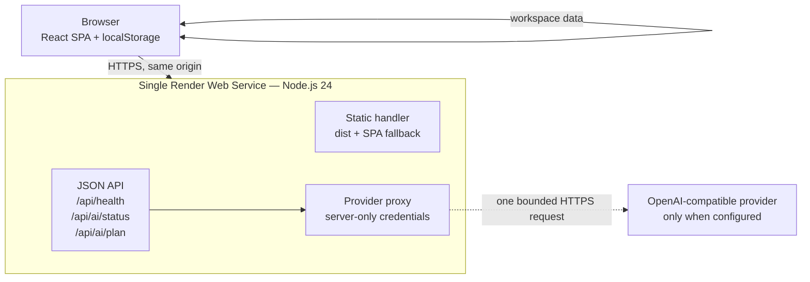

# UTSAV AI — Deployment Guide

**Status:** a **public static demo is live** at **[https://utsav-ai-9evw6i99uw4.qoder.website](https://utsav-ai-9evw6i99uw4.qoder.website)**. The optional single-service Node API is prepared and verified locally but **is not deployed**. This guide records the live static deployment first, then the prepared Node/Render alternative.

## Current deployment

| Item | Value |
| --- | --- |
| Host | Qoder Sites |
| URL | `https://utsav-ai-9evw6i99uw4.qoder.website` |
| Published content | The production `dist/` build from `npm run build` |
| Routing | SPA fallback enabled; HTML navigations to deep routes return the app shell with `200` |
| Access | Public |
| Backend | None. `/api/ai/*` and `/api/health` are not hosted |
| Data | Browser `localStorage` per origin; no accounts, server database, or sync |
| AI | The AI Planner reports **Unavailable**; the deterministic outline remains usable and is labelled **Not AI-generated** |

Verified on 2026-10-26:

- The HTTPS homepage returned `200` with the expected title; `/rescue`, `/budget`, and `/assistant` returned the SPA shell for `Accept: text/html`, and hashed assets returned `200`. A missing asset returned `404`.
- In a browser, the dashboard rendered the labelled sample workspace, Event Rescue completed a deterministic analysis with findings and a correctly disabled approval when no changes existed, and the AI Planner disabled AI generation while the local outline worked.
- Marking a task complete persisted across a reload on the hosted origin.
- After republishing the corrected build, Event Rescue analysis stored a rescue snapshot with a 2,469-character event signature; reloading `/rescue` kept the snapshot and displayed no salvage notice.
- The only console error observed was the expected `404` for `/api/ai/status`, because the optional API server is not hosted. The UI surfaces this as **Unavailable** and does not fabricate a provider response.

Observed limits:

- `/api` is a reserved platform namespace on this host, so the Node API cannot be reached under its existing same-origin paths. Hosting provider-backed AI requires deploying the Node service described below or porting the proxy to a supported server function.
- The observed platform response headers did not include a Content-Security-Policy or `X-Frame-Options`. HTTPS is platform-terminated.
- The host adds a visible Qoder attribution watermark with a hide control.
- Browser data is scoped to this origin. Changing the address or origin does not migrate an existing workspace.
- Updates are published from the same project and preserve the public address; source changes require a new build and publication.

## 1. Hosting architecture (prepared Node/Render alternative)

The alternative target is **one Render Web Service** running Node.js 24. That service serves the built React application and the optional same-origin AI API. There is no database or separate backend service.

### Selected architecture



- **Frontend:** the Vite production build in `dist/`. The Node server serves its files and falls back to `index.html` for client-side routes such as `/rescue`.
- **Backend:** the existing stateless Node HTTP API in `server/`. It exposes `GET /api/health`, `GET /api/ai/status`, and `POST /api/ai/plan`.
- **Database:** none. Events, budgets, tasks, guests, activities, risks, and proposals remain in the visitor's browser storage.
- **External service:** an OpenAI-compatible provider is optional. Without server-side credentials, the AI Planner reports **Not configured** and the deterministic local outline remains available.
- **Origin:** the browser calls `/api` on the same origin that served the page. No CORS grant is added.

### Why this shape fits the project

- The core application is a static SPA. The only server work is the optional provider proxy, so a database, queue, worker, and second deployment would add infrastructure without adding product capability.
- The current API deliberately returns no CORS headers. Serving the frontend and API from one origin preserves that boundary without weakening it.
- A single long-running Node service preserves the existing `node:http` request handling, bounded body reads, rate limiter, and provider timeout behavior. No serverless body-parsing adapter or duplicated API layer is required.
- Render supports a Node web service, an explicit start command, health checks, TLS termination, and platform-provided `PORT` values. The repository pins Node **24.16.0** with `.node-version`.
- Render's free web-service plan may spin down after inactivity and take time to wake. Use a paid instance or warm the service before a live demonstration if that cold-start behavior is unacceptable.

### Alternatives considered

- **Vercel static frontend only:** simple and reliable for the planner, but the optional AI API cannot run as the current long-running Node server. With no `/api` service, AI would be permanently unavailable, or a separate proxy/serverless adapter would be needed.
- **Vercel frontend plus a separate backend host:** the browser would call a different origin. The server intentionally has no CORS support, so this would require either a public CORS policy or an additional proxy. Neither is prepared.
- **Managed database:** unnecessary. The application has no server-side records, accounts, or synchronization model. Adding a database would not migrate existing browser data safely or create multi-user behavior by itself.

The repository therefore targets **one same-origin Node service**, not a frontend/backend split.

## 2. Prerequisites

- A Render account and a Git repository containing this project. Connecting the repository and creating the service are user actions.
- Node.js **24.16.0** locally for parity, and Node.js `>= 24.15.0` as declared in `package.json`.
- npm with the committed `package-lock.json`.
- No database, Docker image, object storage, or DNS record is required.
- Optional: an OpenAI-compatible provider key and model with a spending limit. The application works without them.
- Explicit authorization before creating or publishing a deployment.

## 3. Required environment variables

Set these in the Render Dashboard under the service's **Environment** settings. `render.yaml` sets the non-secret production values; AI credentials must be added manually if wanted.

| Variable | Required | Secret | Default / expected | Purpose |
| --- | --- | --- | --- | --- |
| `SERVE_STATIC` | Yes for a usable web app | No | `true` in `render.yaml` | Enables serving `dist/` and SPA fallback. If false, only `/api` routes respond. |
| `AI_SERVER_HOST` | Yes on Render | No | `0.0.0.0` in `render.yaml` | Binds the public web service. Local default is `127.0.0.1`. |
| `NODE_ENV` | Recommended | No | `production` in `render.yaml` | Standard environment marker; no local-only behavior is enabled by another value. |
| `PORT` | Injected by Render | No | Platform-provided | The server uses it when `AI_SERVER_PORT` is unset. Do not hard-code a port in the repository. |
| `AI_SERVER_PORT` | No | No | none | Optional explicit port; takes precedence over `PORT`. Leave unset on Render unless you have a specific reason. |
| `STATIC_DIR` | No | No | `dist` | Directory containing `index.html` and built assets. The server fails clearly at startup if static serving is enabled and this file is missing. |
| `AI_PROVIDER_API_KEY` | No | **Yes** | none | Server-side provider key. Add only in the hosting dashboard or a local ignored environment file. |
| `AI_MODEL` | No | No | none | Provider model identifier. Required when a key is set. |
| `AI_BASE_URL` | No | No | `https://api.openai.com/v1` | OpenAI-compatible Chat Completions base URL. |
| `AI_PROVIDER_NAME` | No | No | `OpenAI-compatible provider` | Safe display label returned by the status endpoint. |
| `AI_REQUEST_TIMEOUT_MS` | No | No | `20000` | Whole number from `1000` to `120000`. |
| `AI_MAX_OUTPUT_TOKENS` | No | No | `1800` | Whole number from `256` to `8192`. |
| `AI_MAX_REQUEST_BYTES`, `AI_RATE_LIMIT_MAX`, `AI_RATE_LIMIT_WINDOW_MS` | No | No | `96000`, `10`, `60000` | Validated request-size and rate-limit bounds. Values outside the documented ranges are rejected or defaulted at startup. |

Do **not** create a `VITE_*` variable for any credential or API URL. `VITE_*` values are compiled into the public browser bundle. The browser already uses the relative path `/api`, so no frontend API base URL is required.

### How to set variables on Render

1. Open the service in the Render Dashboard.
2. Go to **Environment**.
3. Add `AI_PROVIDER_API_KEY` and `AI_MODEL` only if you intend to enable AI; mark the key as secret.
4. Leave the key blank or absent for a public demonstration that should not make paid provider calls.
5. Save and redeploy the service so the process starts with the new environment.

`render.yaml` deliberately does not contain AI credentials. Do not paste a real key into a committed YAML file, README, screenshot, issue, or browser console.

### Behavior when AI credentials are missing

- `/api/health` still returns `200` and `{"status":"ok"}`.
- `/api/ai/status` returns `configured: false` with a safe message.
- `POST /api/ai/plan` returns a safe `503 not-configured` response and does not call a provider.
- The AI Planner disables **Generate AI plan** and keeps **Build deterministic outline** available, labelled **Not AI-generated**.
- All budget, rescue, risk, task, guest, timeline, catering, persistence, and export/import features work normally.

If `SERVE_STATIC=true` is set but `dist/index.html` is missing, the server exits with a clear startup error. Run the build before starting the process.

## 4. Frontend deployment instructions

In the prepared Render topology, the frontend is not deployed separately. It is built in the same Render service that runs the API. (The live static demo is a separate Qoder Sites publication described in [Current deployment](#current-deployment), not a Render service.)

### Option A — Blueprint

The repository contains [`render.yaml`](../render.yaml) with the web-service definition.

1. Place the project in a Git repository that you control, if it is not already there. This preparation work did not create a remote or push anything.
2. In Render, create a new **Blueprint** from that repository.
3. Review the detected service. The build runs `npm ci --include=dev && npm run build`; the start command is `npm start`; the health check is `/api/health`. `--include=dev` matters because `NODE_ENV=production` makes npm omit dev dependencies by default, and Vite, TypeScript, and Tailwind are dev dependencies needed by the build.
4. Add optional AI environment variables in the Dashboard if needed. Do not add them to version control.
5. Apply the Blueprint. This is the deployment action; it is not performed by this repository's preparation.

### Option B — Manual Web Service

Use these settings if you do not use the Blueprint:

| Setting | Value |
| --- | --- |
| Type | Web Service |
| Runtime | Node |
| Root directory | repository root |
| Build command | `npm ci --include=dev && npm run build` |
| Start command | `npm start` |
| Health check path | `/api/health` |
| Plan | Free or paid; free may sleep when idle |

Set `SERVE_STATIC=true`, `AI_SERVER_HOST=0.0.0.0`, and `NODE_ENV=production` in the service environment. Render supplies `PORT`. Do not use `dist` as a separate static-site publish directory; the Node process serves it.

The build output path is `dist/`. Hashed files under `dist/assets/` are served with a long immutable cache policy, while `index.html` and SPA fallbacks are served with `no-cache` so a new deployment is visible after reload.

Custom domains and HTTPS are platform concerns. Use the Render-provided HTTPS URL first. If you later change the origin, remember that browser data is scoped to the previous origin and will not follow automatically.

## 5. Backend deployment instructions

There is no separate backend deployment. `npm start` runs `server/index.ts` with Node 24's native TypeScript execution, loading only environment variables supplied by the platform.

- The process listens on `AI_SERVER_HOST:PORT`; Render requires `0.0.0.0`.
- `GET /api/health` is the lightweight platform health check and returns `{"status":"ok"}` without contacting an AI provider.
- `GET /api/ai/status` reports safe provider configuration metadata and limits.
- `POST /api/ai/plan` validates the request, applies limits, makes one bounded provider attempt when configured, validates output, and returns a safe JSON envelope.
- The server is stateless with respect to planning data. It does not store users, events, prompts, or guest records.
- Run **one instance** unless you first replace the in-memory rate limiter with a shared store. Multiple instances would each maintain separate counters and is not prepared.
- Static serving and the API share one process. Do not point a separate reverse proxy at the API assuming CORS support; the API returns no CORS grant by design.

## 6. Database setup

There is no database.

| Data | Location | Backup |
| --- | --- | --- |
| Events, budgets, tasks, guests, activities, risks, AI proposal state | Browser `localStorage` under the origin that serves the app | User-initiated JSON export from Settings |
| Server processes | Memory only | None |
| Server filesystem | Build output and process files; not a data store | None |

Consequences for a deployment:

- A visitor's workspace is separate from every other visitor's workspace.
- The same person on another browser, profile, or device does not see the same data automatically.
- Clearing site data can remove the workspace.
- Changing from a Render URL to a custom domain changes the storage origin.
- No server-side migrations or connection strings are required.
- Do not describe this deployment as providing cloud backup, accounts, or sync.

Export a workspace before clearing browser storage or changing origins. Import is a replace operation and requires confirmation in the UI.

## 7. CORS and API URL configuration

- The frontend uses the relative URL `/api` in `src/features/ai/aiClient.ts`. There is no client environment variable for a separate API host.
- Because the page and API are served from the same Render origin, no CORS request is made.
- The API does not send `Access-Control-Allow-Origin`; this is intentional. Do not add wildcard CORS to make a split deployment work.
- TLS is terminated by the hosting platform. The repository does not include certificates or a reverse-proxy configuration.
- If a custom domain is added, keep the app and `/api` on that same domain.

A separate backend origin is **not a supported configuration in this repository**. It would require a deliberate security and proxy design, which is not prepared here.

## 8. Post-deployment smoke tests

Replace `<your-service-url>` with the URL Render shows after deployment. Do not treat a placeholder as a live URL. Record the actual results; do not report success unless the commands return the expected responses.

### Command-line checks

```bash
export APP_URL='https://<your-service-url>'

curl -fsS "$APP_URL/api/health"
# Expected: {"status":"ok"}

curl -fsS "$APP_URL/api/ai/status"
# Expected: JSON status. configured is false unless both AI_PROVIDER_API_KEY
# and AI_MODEL are valid on the server.

curl -sS -D - -o /dev/null "$APP_URL/"
# Expected: HTTP 200; Content-Type text/html; X-Content-Type-Options: nosniff

curl -sS -D - -o /dev/null "$APP_URL/rescue"
# Expected: HTTP 200; text/html; this is the SPA fallback for a direct load.

curl -sS -o /dev/null -w "%{http_code}\n" "$APP_URL/assets/does-not-exist.js"
# Expected: 404

curl -sS -o /dev/null -w "%{http_code}\n" \
  -X POST -H 'Content-Type: application/json' --data '{}' "$APP_URL/api/ai/plan"
# Expected: 503 when AI is unconfigured; a safe JSON error, not an HTML page.

curl -sS -D - -o /dev/null "$APP_URL/api/not-a-route"
# Expected: 404 JSON and no Access-Control-Allow-Origin header.
```

Also confirm that no response contains a provider key, provider body, prompt, guest data, stack trace, or `VITE_`-prefixed secret. Do not paste real environment values into a smoke-test command.

### Browser checks

Use a fresh browser profile so prior `localStorage` does not influence the result.

1. Open `<your-service-url>/` and confirm the Overview page renders without console errors.
2. Open **My Events**, inspect an event, and cancel the edit dialog. Confirm nested navigation works.
3. Navigate directly to `/rescue?event=sample-ananya-rohan-wedding` and reload. Confirm the rescue page renders instead of a 404. This verifies the SPA fallback.
4. Open **Budget Planner** for the sample wedding and confirm the total is `₹45,00,000` and protected categories remain protected.
5. Run the Event Rescue budget-reduction scenario from [DEMO_SCRIPT.md](DEMO_SCRIPT.md): total `₹42,00,000`, analyze, review the proposal, and verify that nothing changes until **Accept proposal** is confirmed.
6. Open the **AI Planner**. With no provider configured, confirm **Not configured**, disabled generation, and an available deterministic outline labelled **Not AI-generated**.
7. If AI is configured, make **one** explicit test request, verify the proposal preview appears only after validation, and confirm that no proposal is applied without approval. Watch provider spend and rate limits. This verifies only that one configured path worked at that moment; it is not a model-quality evaluation.
8. Export from **Settings**, then import the same file into a disposable profile if you need to verify the backup path. Do not import over data you cannot reconstruct.

### Deployment verification state

Only after these checks pass against the actual Render URL may the project be described as **deployed and publicly accessible**. Local verification of the production build does not establish that the hosted environment, DNS, TLS, headers, provider, or Render behavior is correct.

## 9. Troubleshooting

### The service exits at startup with a missing `index.html` error

`SERVE_STATIC=true` is set but the configured `STATIC_DIR` does not contain `index.html`. Run `npm ci --include=dev && npm run build` in the same deployment, confirm the build command succeeded, and keep `STATIC_DIR=dist` unless you intentionally use another directory.

### The root URL returns a JSON 404

`SERVE_STATIC` is not `true`, or the app is running the API-only start path. Set `SERVE_STATIC=true` and redeploy. Local `npm run dev:api` is intentionally API-only unless you set that variable.

### Render reports a Node version or TypeScript error

Confirm the service uses Node 24. The repository includes `.node-version` with `24.16.0`; Render also accepts a `NODE_VERSION` environment variable. Node 24's native TypeScript execution is required by `npm start`.

### The health check fails

- Confirm `AI_SERVER_HOST=0.0.0.0` on Render.
- Do not manually set `PORT` to a fixed value; let Render inject it.
- Confirm the process is running `npm start`, not `npm run dev` or `npm run preview`.
- Check the Render logs for `[app] Listening` and any safe configuration notes.

### A nested route works in the app but 404s on direct load

The request is not reaching the Node app server, or static serving/SPA fallback is disabled. This can happen if you deploy `dist/` as a plain static site with no rewrite rule. Use the prepared single-service architecture or add equivalent host-level SPA fallback deliberately.

### AI Planner says “Not configured”

Set both `AI_PROVIDER_API_KEY` and `AI_MODEL` in the Render service environment, save, and redeploy. Confirm the values do not have a `VITE_` prefix. Missing credentials are not an application failure; the deterministic outline remains usable.

### AI Planner says “Unavailable”

The browser could not get a valid `/api` response. Confirm the same service serves the app and API, the health check passes, and the service is awake. Check provider configuration only after the status endpoint is reachable.

### Provider error, timeout, rate limit, or invalid response

The server maps failures to safe status codes and messages. Check the provider account, model, base URL, quota, and JSON-output support. The server makes one bounded attempt, has no retry loop, and does not log prompts or provider bodies. A `429` response is the app's own rate limit; wait for the window to expire.

### The rate limit behaves like a shared quota

The limiter is in-memory and keyed from the incoming socket address. Behind a hosting proxy, several clients may share an apparent address. It is a safety bound, not a precise per-user billing control. Use a restricted provider key and a provider-side spending limit. Do not scale to multiple instances expecting a shared counter.

### Data appears to have disappeared

Browser storage is scoped by origin. Check whether the URL changed (for example, a Render URL versus a custom domain or `localhost`), whether you are in a different browser profile, or whether site data was cleared. Export from the origin that still has the workspace. There is no server-side recovery.

### The free service is slow on first request

Render's free web services may sleep when idle. Open the service or run the demo briefly before recording. A paid instance can avoid this behavior; the repository does not change it.

### A deployment is using an old bundle

Confirm the build step completed and the service restarted. Hashed assets are immutable, but `index.html` is served with `no-cache`. If the app still looks stale, hard-reload once and check the Render deploy log.

## 10. Known deployment limitations

- **Only the static demo is deployed:** the public Qoder Sites deployment serves the built SPA. The Render/Node service, `/api` routes, and provider proxy have not been deployed, and no provider call was made.
- **No Node API on the static host:** `/api/ai/status` returns the platform's `404` and the AI Planner reports **Unavailable**. The deterministic outline remains available.
- **Browser-only persistence:** no database, accounts, multi-user isolation, cloud backup, or cross-device sync. Clearing storage can delete data.
- **Public AI risk (prepared Node service):** if a provider key is configured, the unauthenticated `/api/ai/plan` endpoint can be called by anyone who can reach the service. Rate limiting is in-memory and not a billing guarantee. Use a restricted key and provider spending cap, or leave AI unconfigured for public demonstrations.
- **No Content-Security-Policy:** neither the prepared app and server nor the observed static hosts configure a CSP. This remains a known security gap.
- **No `X-Frame-Options` on the live static site:** the prepared Node server sends it, but the observed static responses omit it. The site cannot be embedded protection-verified there.
- **No authentication or authorization:** anyone with the URL can use the app; all planning data is still local to their browser.
- **Single-instance assumption (Node):** the in-process rate limiter and provider behavior assume one Node process. Horizontal scaling is not prepared.
- **Static server scope:** the Node static handler supports the Vite output and SPA fallback; it is not a general-purpose CDN and does not add compression or edge caching. Platform behavior was not independently verified beyond the checks recorded above.
- **Cold starts (Node/Render):** free hosting can sleep, adding latency before the first request.
- **Third-party watermark:** the static host displays a "Made with Qoder" control in the corner with its own hide option.
- **No deployment CI or hosted E2E:** the GitHub Actions workflow runs type checking, linting, tests, and the build, but there is no deployment pipeline, hosted smoke test, or deployment regression suite.
- **No live provider verification:** mocked tests establish the validation and failure paths, not model quality, latency, cost, or provider terms.
- **License:** the repository is MIT-licensed; deployment does not change that. See the root README.

For local setup and test commands, see [SETUP.md](SETUP.md). For architecture and trust boundaries, see [ARCHITECTURE.md](ARCHITECTURE.md). For feature status, see [FEATURE_STATUS.md](FEATURE_STATUS.md).
